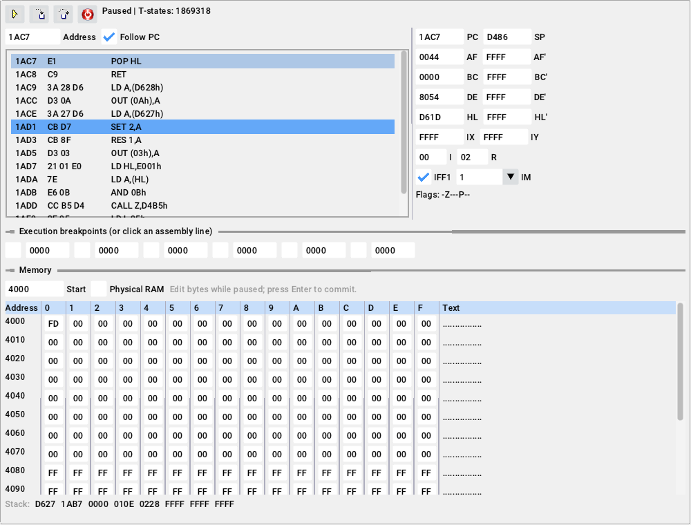
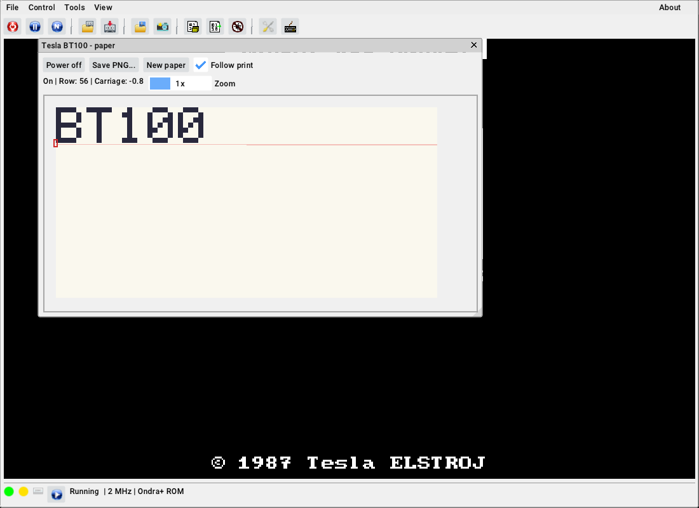

# Ondra — C++11

Nativní emulátor počítače **Ondra SPO 186**, převedený z
[omikron88/jondra](https://github.com/omikron88/jondra). Procesor emuluje
[redcode/Z80](https://github.com/redcode/Z80), obraz, klávesnici a zvuk zajišťuje
SDL2. Java ani JVM nejsou potřeba. Vlastní kód používá výhradně C++11,
procesorové jádro je v C99.


Grafické rozhraní navazuje na původní JOndru: menu, lišta s původními ikonami,
LED, ovládání pásky, dialog nastavení a debugger. Používá staticky připojené
Dear ImGui nad SDL2; font i obrázky jsou součástí programu.

Verze 0.3.0 doplňuje bateriové RTC DS1307 v OndraSD a opravy pulsu INT
a zrcadlení I/O. Podporuje také tiskárny Centronics a Tesla BT100.

## Sestavení v Linuxu

Na Debianu/Ubuntu:

```sh
sudo apt install build-essential cmake ninja-build libsdl2-dev
cmake -S . -B build -G Ninja -DCMAKE_BUILD_TYPE=Release
cmake --build build
ctest --test-dir build --output-on-failure
./build/ondra
```

CMake musí být alespoň 3.16. Na jiných distribucích stačí odpovídající balíčky
C/C++ překladače, CMake a vývojové SDL2 alespoň 2.0.18. Procesor Z80, Zeta
a Dear ImGui jsou součástí zdrojových kódů v `third_party`; sestavení s nainstalovaným
SDL2 nepotřebuje připojení k síti ani Git submoduly.

Alternativně lze SDL2 stáhnout a sestavit z připnuté, kontrolním součtem ověřené
verze:

```sh
cmake -S . -B build -DONDRA_FETCH_SDL2=ON -DCMAKE_BUILD_TYPE=Release
cmake --build build --parallel 4
```

Pro skutečné okno a zvuk musí mít sestavované SDL2 k dispozici vývojové závislosti
X11/Wayland a zvukového systému. Proto je v Linuxu doporučen distribuční balíček
`libsdl2-dev`. Ovladače dostupné ve staženém SDL vypíše CMake při konfiguraci.

## Windows / MSYS2

Nainstalujte [MSYS2](https://www.msys2.org/) a otevřete terminál **MSYS2 UCRT64**.
Aktualizujte jej podle pokynů MSYS2 a pak spusťte:

```sh
pacman -S --needed mingw-w64-ucrt-x86_64-gcc mingw-w64-ucrt-x86_64-cmake \
  mingw-w64-ucrt-x86_64-ninja mingw-w64-ucrt-x86_64-SDL2
cmake -S . -B build -G Ninja -DCMAKE_BUILD_TYPE=Release
cmake --build build
ctest --test-dir build --output-on-failure
./build/ondra.exe
```

Použijte CMake a GCC ze stejného prostředí UCRT64. Pro MINGW64 použijte všechny
balíčky s prefixem `mingw-w64-x86_64-` v terminálu MINGW64. Nekombinujte je
s balíčky UCRT64 nebo s MSYS překladačem z `/usr/bin`.

Ve výchozí dynamické variantě zajistí terminál MSYS2 dostupnost runtime DLL. Při kopírování
programu mimo MSYS2 přibalte potřebné knihovny z `ucrt64/bin` (SDL2, libstdc++,
libgcc, případně libwinpthread); jejich skutečný seznam ukáže
`objdump -p build/ondra.exe`. ROM a zvukové vzorky jsou vloženy přímo do programu.
Není potřeba samostatný adresář s ROM nebo zvukovými daty.

### Samostatné EXE bez přibalovaných DLL

Pro Windows lze SDL2, libstdc++, libgcc i libwinpthread připojit staticky.
V terminálu **MSYS2 UCRT64** použijte novou sestavovací složku:

```sh
pacman -S --needed mingw-w64-ucrt-x86_64-gcc mingw-w64-ucrt-x86_64-cmake \
  mingw-w64-ucrt-x86_64-ninja
cmake -S . -B build-static -G Ninja -DCMAKE_BUILD_TYPE=Release -DONDRA_STATIC=ON
cmake --build build-static --parallel 4
ctest --test-dir build-static --output-on-failure
./build-static/ondra.exe
```

Na jiný počítač s Windows 10/11 pak stačí přenést **`ondra.exe`**. Pro běh
nepotřebuje instalaci SDL2, MSYS2 ani DLL z adresáře `ucrt64/bin`. ROM i zvukové
vzorky jsou již součástí EXE. Zůstávají závislosti na systémových DLL Windows,
které jsou součástí operačního systému. Při distribuci přiložte také licenční
texty; CI je přibaluje do archivu.

`ONDRA_STATIC=ON` automaticky stáhne a sestaví připnuté SDL2, i když je v MSYS2
nainstalovaná sdílená verze. Balíček SDL2 tedy pro tuto variantu není potřeba;
první konfigurace vyžaduje internet. Volba podporuje MinGW GCC v UCRT64,
MINGW64 a cross překladač z Linuxu. Sestavení kontroluje importy výsledných
EXE pomocí `objdump` a skončí chybou, pokud najde jinou než systémovou DLL.
Pouhé `-static-libstdc++` by nestačilo, protože ponechává závislost na
libwinpthread.

V [GitHub Actions](https://github.com/omikron88/ondra/actions/workflows/build.yml)
se sestavují obě varianty. Po úspěšném běhu je v části **Artifacts** dostupný
archiv **`ondra-windows-x64-static`** s EXE a licencemi. Statická varianta se
navíc testuje v samostatném adresáři s PATH obsahujícím pouze systém Windows.

Volitelný cross překlad z Linuxu:

```sh
cmake -S . -B build-windows \
  -DCMAKE_TOOLCHAIN_FILE=cmake/mingw64-toolchain.cmake \
  -DONDRA_STATIC=ON -DCMAKE_BUILD_TYPE=Release
cmake --build build-windows --parallel 4
```

Vyžaduje nainstalovaný `x86_64-w64-mingw32-gcc/g++/windres`. Nativní sestavení
v MSYS2 tento toolchain soubor nepoužívá. CI v `.github/workflows/build.yml`
obsahuje nativní linuxové a MSYS2 sestavení včetně testů.

## Používání

```sh
./build/ondra --rom plus
./build/ondra --rom vili27 --tape program.tap
./build/ondra --rom plus --load program.bin --melodik
./build/ondra --sd cesta/ke/karte
./build/ondra --snapshot ulozeno.osn
./build/ondra --rom-a vlastni_a.rom --rom-b vlastni_b.rom
```

Výchozí ROM je BASIC EXP V5. K dispozici jsou `basic`, `tesla`, `vili25`,
`vili27` a `plus`. Vlastní ROM má dva samostatné banky po 2, 4 nebo 8 KiB;
menší banky se opakují v příslušném 8KiB okně jako v JOndře.

Soubor BIN se standardně načte po 100 snímcích, aby ROM nejprve inicializovala
počítač. `--load-after 0` načítá před prvním snímkem. Podporován je blokový formát
OndraSD: blok `01h, adresa LE16, délka LE16, data` a volitelný vstupní bod
`02h, adresa LE16`. Data se načítají do fyzické RAM; běžící program nadále ovládá
mapování ROM a I/O portem A3. Pro soubor bez hlavičky použijte
`--raw soubor --address 0x4000 --pc 0x4000`.

Do okna lze přetáhnout BIN, OSN nebo páskový soubor. Připojení pásky samo
nespouští zavaděč: načítání/nahrávání a motor řídí program v emulovaném počítači.
Přepínač `--record vystup.csw` zaznamenává páskový výstup a uloží jej při ukončení.
Úplný přehled parametrů vypíše `--help`.

V menu **File** lze vybírat pásky, načítat a ukládat OSN snapshoty i bloky
paměti (BIN s hlavičkou nebo surová data). Uložení do existujícího souboru
vyžaduje potvrzení. **Tools → Settings** nabízí ROM, zvuk, Melodik, turbo,
OndraSD, zvětšení, celou obrazovku, CRT řádkování a Scale2x. Volby se ukládají
do `ondra.ini` vedle programu; jiný soubor lze určit `--config soubor.ini`.
`--no-config` vypne načítání i ukládání nastavení. Výslovné parametry příkazové
řádky mají přednost před uloženými volbami.

**Tools → Debugger** otevře disassembler, registry, zásobník, breakpointy
a editor paměti. Registry a bajty se upravují při pauze a potvrzují Enterem;
adresy a hodnoty jsou šestnáctkové. Breakpoint lze přepnout také kliknutím
na instrukci. F3 krokuje instrukci, F7 přejde přes CALL/RST s omezením délky
vykonávání. **Tools → Keyboard** zobrazí obrázek klávesnice a tlačítka kláves.
Při psaní v souborovém dialogu, nastavení a debuggeru se klávesy neposílají
do emulovaného počítače.



Ve ViLi ROM načte první program z pásky prázdný řádek potvrzený klávesou Enter.
V Ondra+ zvolte v úvodním menu „Zavést z pásky“. Generátor TAP používá stabilní
bifázový signál 2 500 bit/s, ověřený skutečným dekodérem v těchto ROM;
nepřebírá závislost původního generátoru na zaokrouhlování Java časovače.

| Klávesa PC | Funkce |
|---|---|
| F1 | Informace a nápověda k ovládání |
| F2 | Pauza / pokračování |
| F3 | Jedna instrukce |
| F4 | NMI |
| F5 / Shift+F5 | Reset se zachováním RAM / studený reset |
| F6 | Přepnutí 2/4 MHz |
| F7 | Krok přes CALL/RST |
| F8 / F9 | Dialog uložení / načtení snapshotu |
| F10 | Ukončit |
| F11 | Celá obrazovka |
| F12 | Dialog uložení obrazu do PPM |
| Home | Převinout pásku |

Písmena a šipky používají mapování původní JOndry: `Shift` = Shift,
`Alt` = Symbols, `Ctrl` = Ctrl, `Tab` = Numbers, `=` = CS. Čísla se zadávají
kombinací Numbers s příslušnou klávesou Ondry. Joystick používá numerickou
klávesnici 8/2/4/6 a 0 jako tlačítko. Při ztrátě fokusu se stisky uvolní.
Zelená/žlutá LED a stav motoru pásky jsou vidět ve spodní liště.

## Tiskárny

V **Tools → Settings → Printers** vyberte **Centronics printer** nebo
**Tesla BT100** a potvrďte **Apply**. Tiskárny a Melodik používají stejný
konektor, proto lze připojit vždy jen jedno z těchto zařízení. Výběr i cesta
k souboru se ukládají do `ondra.ini`.

**Centronics** přebírá bajt z portu 9 na sestupné hraně STROBE (bit 3 portu
0Ah). Přijatá data připisuje beze změn na konec vybraného souboru; stávající
obsah zachová. Výstup obsahuje i řídicí a grafické kódy, nejde o převod na PDF
nebo tisk na systémovou tiskárnu. Emulovaný buffer má 2 KiB, rychlost 200
znaků/s a signál BUSY na bitu 5 v I/O okně, včetně adresy E00Fh. Po každém
bajtu BUSY trvá nejméně 100 µs; plný buffer čekání prodlouží.

**BT100** otevře okno **Tesla BT100 - paper** s vypínačem, náhledem papíru,
polohou hlavy, sledováním tisku, zvětšením, **New paper** a **Save PNG...**.
Zavřené okno lze otevřít přes **Tools → BT100 paper**. Připojení v nastavení
nebo obnovení nastavení po spuštění nechává fyzický vypínač vypnutý. Zapněte jej
až ve chvíli, kdy tiskový program požádá o zapnutí tiskárny, a po tisku vypněte:
její snímače jsou propojené s klávesnicí Ondry a za chodu ovlivňují stisky.
Zavření okna samo o sobě vypínač nevypíná.



BT100 zachovává aktivně nízké výstupy na portu 9 (jehla, oba směry vozíku,
posun papíru), snímače na E009h i jejich vliv na řádky klávesnice. Model má
dráhu −0,75 až 526 bodů, 2ms krok vozíku, 1,5ms rozjezd, 5ms posun papíru
a dvoubodovou korekci při tisku vlevo. Používá výchozí synchronizační okénka
Java modelu. Náhled má šířku 600 bodů; export je černobílé PNG ve zvětšení 2×.
Papír pojme 100 000 řádků bodů; při zaplnění jej uložte a vložte nový.

Z příkazové řádky:

```sh
./build/ondra --no-config --printer tisk.prn
./build/ondra --no-config --bt100
./build/ondra-headless --bt100-output papir.png --raw program.bin \
  --address 0x4000 --pc 0x4000 --load-after 0 --frames 5000
```

`--bt100` a `--bt100-output` tiskárnu také zapnou, takže lze tisknout bez
grafického okna. `--bt100-output` uloží papír při ukončení; přípona je PNG.
Současné zadání tiskárny a `--melodik` skončí chybou. Časování tiskáren zůstává
v reálném čase také v turbu. Reset počítače vyprázdní handshake a zastaví
motory, vytištěný papír a data v souboru zachová. Historický formát OSN stav
tiskáren neukládá.

## Testování a terminálový debugger

Jádro lze sestavit samostatně, bez SDL2 a bez grafického prostředí:

```sh
cmake -S . -B build-headless -DONDRA_BUILD_GUI=OFF -DCMAKE_BUILD_TYPE=Debug
cmake --build build-headless
ctest --test-dir build-headless --output-on-failure
./build-headless/ondra-headless --rom plus --frames 150 --check-boot \
  --screenshot obraz.ppm
./build-headless/ondra-headless --rom plus --debug
```

Headless režim běží bez čekání na skutečný čas. Vypíše registry, počet CPU
T-stavů, rozlišení, počet svítících bodů a FNV-1a hash obrazu. `--check-boot`
ověřuje zapnuté video a neprázdný obraz; samotné CPU a mapování ověřuje test
`core`, který se skládá z dvanácti skupin a více než 12 000 kontrol. Ověřuje i
skutečné načtení syntetického TAP programu pomocí zavaděče v ROM. Samostatné
testy spouštějí každou ROM. Grafické testy používají ovladače `dummy` a skutečné
události myši a klávesnice: pauza, nastavení, krokování, editace registrů
a breakpointů, uložení/načtení snapshotu s českým názvem a zotavení po chybě.
Kontrolují také potvrzení přepsání souboru, BIN dialogy a přednost parametrů
před uloženými nastaveními.

Test `printers` spouští skutečný Z80 ovladač Centronics s čekáním na BUSY,
ověřuje binární připisování, buffer, turbo, chyby souborů, snímače BT100,
polaritu, vůli a zachování papíru při resetu. Výsledky šestnácti střídavých
přejezdů BT100 (snímače a všechny body papíru) porovnává s nezměněnou Java
implementací. Grafický test navíc ověřuje připojení tiskárny, vypnutí Melodiku,
vypínač BT100, nový papír a export PNG přes skutečné události myši a klávesnice.

Test `rtc` ověřuje registry a UART příkazy T/S, CH, režim 12/24 h, půlnoc,
přestupné roky, nezávislý den v týdnu, surové neplatné hodnoty i bateriový stav
přes reset a nové spuštění. Tisíc kombinací registrů a časových posunů má stejný
výsledek jako Java verze. Ověřuje také atributy a čekání OndraSD včetně
jednobajtového SBUF během práce s kartou. Grafický test kontroluje automatické
uložení změněných hodin do nastavení.

Příkazy debuggeru (adresy jsou desetinné nebo s prefixem `0x`/`$`):

```text
r                 registry
s [počet]         instrukční krokování
n                 krok přes CALL/RST (limit 1 000 000 instrukcí)
c [snímky]        pokračovat; výchozí limit 50 snímků
b 0x4000          přidat/odebrat breakpoint na PC
d 0x4000 128      číst mapovanou paměť
w 0x4000 0x3e 1   upravit fyzickou RAM
pc 0x4000         nastavit PC a opustit HALT
in 0xff           číst port
out 3 7           zapsat port
key 5 4 1         stisk matice: řádek, bit, stav (0 = pustit)
load soubor.bin   načíst BIN
save soubor.osn   uložit OSN
loadsn soubor.osn načíst OSN
tape soubor.tap   připojit pásku
reset             studený reset
q                 ukončit
```

## Rozsah a přesnost portu

Implementována je 64KiB RAM, 16KiB okno ROM, I/O v E000–FFFF, aktivně nízká
klávesnicová matice, joystick, adresové aliasy výstupních latchů A0/A1/A3,
proměnné rozlišení, obraz 320 × 256, 50Hz přerušení, NMI, turbo, původní
zvukové vzorky a Melodik se SN76489. Zvuk má 44,1 kHz / 16 bitů / mono.
I/O okno E000–FFFF dekóduje pouze A[3:0], takže klávesnice, joystick, detekce
Melodiku a snímače BT100 se zrcadlí každých 16 bajtů. Puls INT trvá 64 µs:
128 T při 2 MHz nebo 256 T v turbu. Skončí i při zakázaných přerušeních
a při krokování v debuggeru, jakmile emulovaný čas překročí jeho konec.

Pásky: Ondra TAP s kontrolou součtu a volitelným LF/CR oddělením, CSW v1/v2
s RLE (typ 1), WAV mono PCM 8/16 bitů; záznam do CSW v2. Z-RLE/zlib CSW není
podporováno, stejně jako v původní JOndře. Vadné nebo neúplné BIN/OSN obrazy
nezmění RAM částečně.

OndraSD zachovává bitovou sériovou linku 9600/57600 Bd, vysílání `__LOADER.BIN`,
příkazy adresáře/souboru, FAT 8.3 aliasy a RTC. Adresář zadaný `--sd` představuje
kartu. Sektorové CP/M příkazy B/R/W vracejí chybu stejně jako v Javě. Symlinky
mimo kořen karty se nezpřístupňují. Emulátor nemění hostitelské systémové hodiny.
Hledání jména účtuje průchod položkami adresáře. Po souboru BIN a výpisu
adresáře zůstává modul ještě krátce zaměstnaný prací s kartou; v SBUF udrží
jeden příchozí bajt. Atributy položek odpovídají firmware: 51h pro adresář
a 71h pro soubor (soubor rozlišuje bit 5).

### RTC DS1307 v OndraSD

Příkaz **T** vrací sedm registrů 0–6, **S** je zapisuje beze změn, včetně
neplatných BCD hodnot. Model respektuje CH v bitu 7 sekund (zastavení hodin),
12hodinový režim v bitu 6 hodin, AM/PM v bitu 5, nezávislý den v týdnu,
přestupné roky a přechod roku 99 → 00. Při prvním použití se nastaví místní
čas PC; další běh vychází z uplynulého skutečného času, i při pauze nebo turbu.
V bublině nad **SD** ve spodní liště je vidět čas a případné zastavení hodin.

Bateriový stav se ukládá jako `sdRtc=čas_PC_v_ms,R0,...,R6` (registry hex)
do `ondra.ini`, automaticky po zápisu hodin. Reset CPU, restart modulu ani
načtení OSN jej nemaže. Hodiny nejsou součástí historického formátu OSN a jejich
stav se při načtení snapshotu nevrací zpět. Poškozený záznam se nahradí
počátečním nastavením podle PC.

V headless režimu určete soubor pro trvalý stav explicitně; ostatní položky
souboru zůstanou zachované:

```sh
./build/ondra-headless --sd cesta/ke/karte --config ondra.ini --frames 5000
```

`--no-config` vypne načítání i ukládání bateriového stavu. Formát hodnoty je
kompatibilní s `SDRTC` v konfiguraci JOndry; čtení podporuje i tento název klíče.

OSN v1/v2 je kompatibilní s JOndrou a ukládá registry, porty, ROM typ, rozlišení
a fyzickou RAM včetně RAM pod ROM/I/O; vlastní ROM přibalí do obrazu. Tento
historický formát neukládá PSG, polohu pásky, stav přenosu SD, turbo ani rozdíl
ViLi 25/27. Pro ViLi 25 načítejte snapshot s `--rom vili25`; jinak se použije 27.

CPU je instrukčně přesné jádro redcode. Zdržení CPU videem se účtuje po snímcích
podle původní JOndry; nejde o nový model sběrnice po jednotlivých T-stavech.
PSG je samostatná implementace registrů, děličů a šumového LFSR; zvuk zatím
nebyl porovnán měřením s fyzickým Melodikem.

Grafické rozhraní zachovává rozložení a hlavní ovládací prvky Java verze;
dialogy jsou nově implementované v Dear ImGui. Dostupný je také terminálový
debugger. Timeline a zpětné krokování z původní Java verze zatím implementované
nejsou; z rodiny ScaleNx je dostupné Scale2x.

## Uspořádání a licence

`include/ondra` a `src` obsahují přenositelné jádro, souborové formáty a obě
rozhraní. `tests` ověřuje hardware i formáty. `assets` obsahuje nezměněné ROM
a vzorky z JOndry, ikony a font; CMake je vloží do programu. `third_party`
obsahuje nezměněné Z80, Zeta a Dear ImGui, takže lze se systémovým SDL2 sestavit
celý projekt i offline.

Projekt navazuje na GPLv3 JOndru a je vydán pod GPL-3.0-or-later, viz [LICENSE](LICENSE).
Původ a licence převzatých částí jsou uvedeny v [THIRD_PARTY.md](THIRD_PARTY.md).
